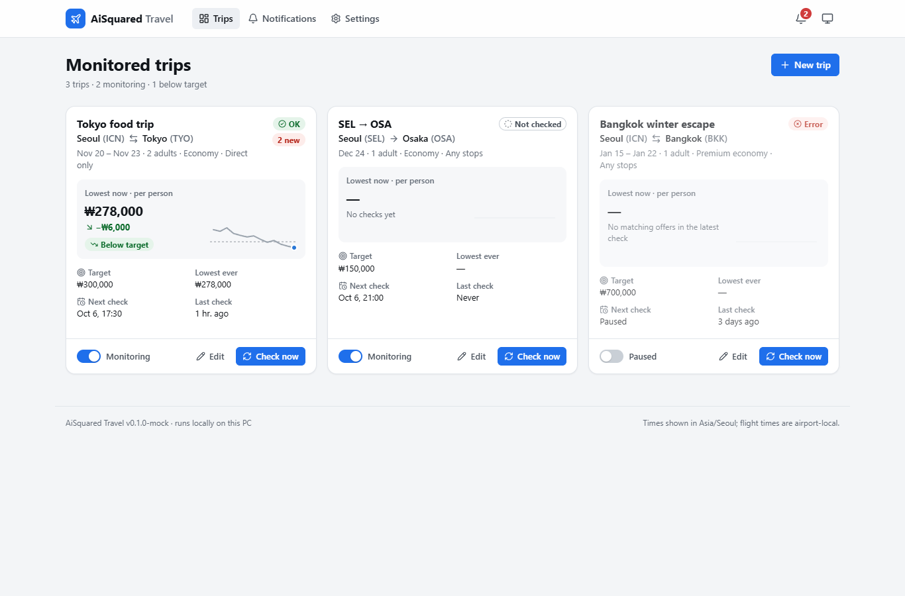

# AiSquared 2.0 — Personal Projects

**This is a personal side project by Wonseok Choi, shared for learning, experimentation, and code review.**

AiSquared contains two local travel-planning applications: a Node.js-based flight-monitoring app called **Wayfinder**, and a separate Python/FastAPI-based **Travel Planner**. Both applications retain their original source layout. Much of the interface and the original documentation is in Korean.

## Learning use and responsibility

This repository is provided for personal learning and experimentation. Users are responsible for complying with each website's terms of service and any applicable access restrictions. Naver data collection is disabled by default and requires explicit opt-in. No permission to collect or reuse third-party data is granted by this repository.

## Version 2.0

This release imports the latest local source updates for both projects, including Wayfinder language-switching UI changes and Travel Planner interface, chart, and booking-preparation updates. `v2.0.0` identifies this repository release; the independent applications retain their own package versions. See [release notes](RELEASE_NOTES.md). Research working notes under `docs/research/` are excluded.

## Two independent personal projects

This repository groups two separate personal projects by **Wonseok Choi**. They explore similar travel-planning ideas but have different implementations, interfaces, and development histories. They are not two components of one application.

### 1. Wayfinder — Developed with Codex

**Development:** A personal project by Wonseok Choi, coded with assistance from OpenAI Codex.

**Location:** repository root (`src/`, `server/`, and `shared/`).

Wayfinder is a Korean-language flight-monitoring and trip-planning application built with **React, Vite, Express, and Node.js SQLite**. It organizes monitored trips, fare history, target-price alerts, flight offers, and itineraries in one interface. Its API and frontend use the root Node.js dependency manifests. See [Run Wayfinder](#run-wayfinder) for setup.

The screenshot below is a historical interface preview from before version 2.0 and comes from an existing browser-test capture with seeded demonstration trips and fares. It illustrates the interface, not current flight prices.


### 2. Travel Planner — Developed with Claude

**Development:** A personal project by Wonseok Choi, coded with assistance from Anthropic Claude.

**Location:** `travel-planner/`.

Travel Planner is a separate application built with **React, TypeScript, FastAPI, SQLAlchemy, and APScheduler**. It includes travel planning, scheduled flight checks, and optional AI and notification integrations. It has its own Python backend, frontend dependencies, configuration, and database. See [Run Travel Planner](#run-travel-planner) for setup.

The screenshot below is a historical mock preview from before version 2.0, taken from the frontend development mock. It shows sample trips and demonstration fares; it is not evidence of live provider results or of the backend running.



## Repository guide

```text
src/                          Wayfinder React interface
server/                       Wayfinder API, providers, and scheduling
shared/                       Shared Wayfinder modules
scripts/                      Wayfinder development and configuration scripts
tests/                        Wayfinder tests and fixtures
public/                       Wayfinder static assets
docs/images/                  Selected interface screenshots for both projects
README.original.md            Original Wayfinder documentation, preserved unchanged
travel-planner/
  backend/app/                FastAPI application and integrations
  backend/tests/              Backend tests
  backend/requirements.txt    Existing Python dependency specification
  frontend/                   React/TypeScript interface and frontend tests
  scripts/                    Windows development and launch scripts
  docs/                       Specification and research notes
  DESIGN.md                   Existing design document
```

## Run Wayfinder

Prerequisites: **Node.js 24 or newer** and npm. The application uses Node.js's built-in SQLite support. Microsoft Edge is used by the configured browser-based flight provider.

From the repository root:

```powershell
npm ci
Copy-Item .env.example .env
npm run dev
```

The default development interface is at `http://localhost:5173`; the API defaults to port `3001`. The example configuration enables demo seed data. Configure integrations before relying on live results; available providers and setup details are described in [the original README](README.original.md).

To build and serve the interface from the backend:

```powershell
npm run build
npm start
```

## Run Travel Planner

The supplied launch scripts target **Windows PowerShell** and a **Python 3.13** virtual environment. Node.js and npm are also required for the frontend.

Starting from the repository root:

```powershell
cd travel-planner
py -3.13 -m venv .venv
.\.venv\Scripts\python.exe -m pip install -r backend\requirements.txt
Copy-Item .env.example .env

cd frontend
npm ci
npm run build
cd ..

.\scripts\run.ps1 -NoBrowser
```

Open `http://127.0.0.1:8765`. Review `travel-planner/.env.example` for provider, scheduling, and notification settings. Optional integrations require their own credentials and setup. See the [specification](travel-planner/docs/SPEC.md), [design notes](travel-planner/DESIGN.md) for details.

Dependency manifests and lockfiles are preserved as supplied. Both frontends built successfully using the existing local dependencies; clean dependency installation was not repeated.

## Tests and review

Existing test suites are included for reviewers:

| Area | Command and working directory |
| --- | --- |
| Wayfinder unit tests | `npm test` from the repository root |
| Wayfinder UI tests | `npm run test:ui` from the repository root |
| Travel Planner backend | `..\.venv\Scripts\python.exe -m pytest` from `travel-planner/backend` |
| Travel Planner frontend | `npm test` from `travel-planner/frontend` |

Some browser or live-provider tests need additional setup or credentials. Consult the test configuration before enabling live tests. For version 2.0, both frontend builds passed, along with 45 Wayfinder tests, 81 Travel Planner frontend tests, and 89 focused backend tests. Live provider calls and full end-to-end workflows were not run.

## Snapshot contents

After the initial import, this README was expanded to describe the two projects separately, and two selected existing screenshots were added under `docs/images/`. The application source remains unchanged.

This initial upload preserves the selected original files byte for byte. The original root README is retained as `README.original.md`; this English overview and a Git attributes file were added for sharing. No application code, existing comments, dependencies, or behavior were changed.

Source code, dependency manifests, tests, fixtures, design documents, static images, and the backend airport reference catalog are included. Installed packages, virtual environments, build output, runtime databases and logs, caches, bulk generated screenshots, local environment files, and browser/session or credential storage are excluded. Runtime state is created locally when the applications run.

Keep personal configuration and credentials outside version control. This repository is intended for review and personal experimentation; the source documentation describes its local operating assumptions and limitations.

## API credentials

Claude integration in Travel Planner and OpenAI integration in Wayfinder are retained. Each user must provide their own credentials locally. The `.env.example` files are templates, not working credentials. Never paste real keys into source files, screenshots, issues, or commits.

Local `.env` overrides, runtime data, credential directories, browser storage-state files, and private key files are excluded by Git ignore rules. These rules do not remove files that are already tracked and do not replace a review before pushing. Tests contain deliberately invalid credentials for mocked or opt-in negative authentication checks.
