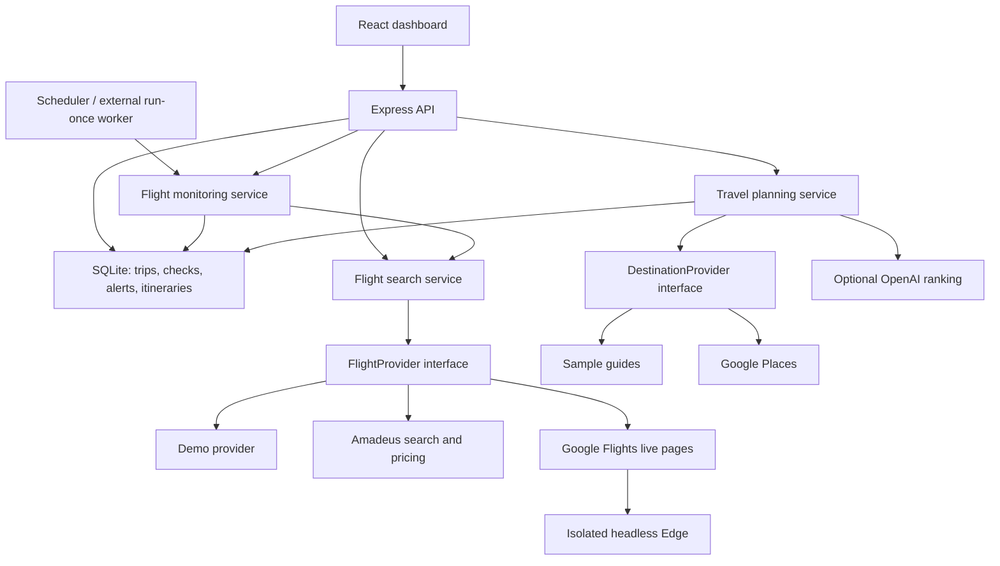

# Wayfinder

한국어 화면으로 항공권 가격 확인, 알림 설정, 여행 일정 생성과 내려받기를 사용할 수 있습니다.

## 실제 항공권 요금 검색

1. 왼쪽 메뉴의 **실시간 항공권**을 엽니다.
2. 공항 코드, 왕복/편도, 날짜, 성인 인원, 좌석 등급을 입력한 뒤 **실제 항공권 검색**을 누릅니다.
3. 실제 검색된 항공사·편명·현지 출발/도착 시각·비행시간·경유 횟수와 원화 요금을 비교합니다. **요금 기준**으로 1인 요금과 전체 인원 총액을 구분하고 최대 요금으로 제한할 수 있습니다.
4. **이 검색으로 모니터링**을 누르면 실제 요금 여행을 새로 등록하여 가격 기록과 앱 내 알림을 사용합니다. 기존 데모 여행의 가격 기록을 섞지 않습니다.

기본 실제 검색 서비스는 **Google 항공편**입니다. 이웃 `travel-planner` 프로젝트의 Google 페이지 데이터 해석과 귀국편 조회 방식을 Node 버전으로 옮겼습니다. **Microsoft Edge가 설치되어 있으면 API 키 없이 사용할 수 있습니다.** 새 여행도 이 서비스를 기본으로 선택합니다. 데모는 명시적으로 선택할 때만 예시 요금을 제공합니다. 기존 데모 여행은 그대로 유지됩니다.

왕복 검색 목록의 금액은 표시된 출발편과 조합할 수 있는 귀국편 중 **전체 성인 인원의 왕복 최저 표시 요금**입니다. 1인 금액은 총액을 인원으로 나눕니다. 귀국편 선택 후 최종 금액이 달라질 수 있으며 수하물은 제공된 정보만 표시합니다. 처음 목록에서 귀국편 시간을 추정하지 않습니다. 일정 생성 시 출발편을 선택한 검색을 한 번 더 조회하여 실제 귀국편과 해당 왕복 요금을 확인합니다. 편도 검색에는 귀국편을 만들지 않습니다.

조회 시각과 출처를 표시하며 동일한 검색은 최대 60초간 재사용합니다. Edge는 개인 브라우저 프로필과 분리된 임시 세션을 사용합니다. 요청은 한 번에 하나씩 5초 이상 간격을 두며 유연한 검색은 4개 조합으로 제한합니다. 접근 제한·CAPTCHA에 응답하거나 우회하지 않으며, 제한 시 4시간 자동 조회를 쉬고 기존 요금 기록을 보존합니다. Google 페이지 형식이 바뀌면 검색 실패를 명시하고 직접 확인할 수 있는 링크를 제공합니다. Google은 공식 API가 아닌 페이지 조회 방식이므로 결과와 안정성에 제약이 있습니다.

## 항공권 예약하기

1. 대시보드에서 여행을 선택하고 **일치 항공편** 탭을 엽니다.
2. 원하는 항공편의 **날짜 넣고 항공권 검색**을 누릅니다. Google 항공편의 검색 결과를 새 탭에서 엽니다. 출발·도착 공항, 왕복/편도, 실제 항공편 날짜, 성인 인원, 좌석 등급이 자동 입력됩니다. 버튼 아래에서 전달할 조건을 미리 확인할 수 있습니다.
3. Google 항공편에서 원하는 항공편을 선택하고 예약처 링크로 이동하여 실제 요금과 수하물 조건을 확인한 뒤 예약·결제합니다. 항공사와 직항 등 추가 조건은 검색 결과에서 확인하세요.

항공사 홈페이지 링크와 날짜가 무시되는 검색어 링크를 날짜가 입력된 검색 링크로 교체했습니다. 기존에 저장한 항공편과 가격 알림도 다시 검색하지 않고 사용할 수 있습니다. 유연한 날짜·인근 공항으로 찾은 항공편은 실제 제공된 날짜와 공항을 전달합니다. Google 실제 검색 결과는 출발편을 선택한 귀국편 목록으로 연결하고, 편도 결과는 해당 편의 예약 옵션으로 연결합니다. **데모 가격은 예시이며 실제 가격이나 좌석을 보장하지 않습니다.** 결제는 예약처에서 진행합니다.

Google의 공개 공유 URL 형식은 변경될 수 있습니다. `npm run test:booking`은 Edge에서 실제 외부 검색 화면의 날짜·인원·좌석 등급을 검사합니다. 일반 UI 테스트와 분리되어 있으며 인터넷 연결이 필요합니다.

A local flight-price monitoring and travel-planning MVP built from your specification. React + Vite provide the interface; a modular Node API, SQLite database, and background scheduler handle trips, fare observations, alerts, and saved itineraries.

## Run it

Requires Node 24 or newer. Microsoft Edge is already supported; no Chrome installation is needed.

```powershell
npm install
npm run build
npm start
```

Open **http://127.0.0.1:3001** in Edge. For development, run `npm run dev` and open **http://127.0.0.1:5173**. The development command runs both the API and Vite.

The first launch creates two explicitly labeled demo trips with simulated price history and a sample Tokyo itinerary. Demo prices change with each check to demonstrate alert rules. Set `SEED_DEMO=false` before the first launch for an empty workspace. Deleting demo trips is permanent; they are not recreated on restart.

## Implemented

- Create, edit, search, pause, resume, and delete monitored trips.
- One-way/round-trip dates, 1–2 adults, four cabins, direct-only filtering, local outbound departure/arrival windows, overnight time windows, ±1/3/7-day flexibility, catalog-based nearby airports, and alternative destination codes.
- Explicit KRW **per-person** or **all-travelers** amounts for fare thresholds and travel budgets.
- Daily, twice-daily, and 1–168-hour schedules with an IANA timezone; the sample uses `Asia/Seoul` and 08:30/17:30.
- Persistent fare observations, matching flight details, baggage when supplied, previous/lowest fares, interactive history chart, and history table.
- Target-price crossing, percentage drop, and new historical-low alerts in a persistent in-app inbox. Multiple rules produce one combined alert per check. Unchanged below-target fares do not repeatedly trigger the target rule.
- Google Flights live fares through Edge without an API key, plus explicit demo and Amadeus search/repricing adapters. Live, demo, and test results are kept separate.
- Travel-style weights, solo/couple/family preferences, cuisine, food interests, meal limits, and category budgets. `0` or `-1` removes a budget cap while keeping reasonable estimates.
- Saved, geographically grouped, day-by-day itineraries tied to the selected flight's actual destination arrival and return departure. Includes transfer/check-in buffers, meal breaks, estimated transit, budget accounting, source links, schematic route view, Google Maps route links, and Markdown export.
- Optional OpenAI ranking of supplied places and optional Google Places retrieval of restaurants, attractions, ratings, and regular weekly hours.
- Windows DPAPI-encrypted integration secrets; credentials stay on the server and are not returned by the API.
- Responsive interface verified in Microsoft Edge.

## Connect real services

Copy `.env.example` to `.env` for **nonsecret settings**. Keep API keys out of `.env`, source files, and the database.

On this Windows machine, run the configuration helper from the project directory:

```powershell
powershell.exe -NoProfile -ExecutionPolicy Bypass -File .\scripts\configure-integrations.ps1
```

It prompts securely for Amadeus credentials, an OpenAI API key, and a Google Places API key. Press Enter to skip a service or keep a previously configured value. Values are encrypted using Windows DPAPI in `.secrets/integrations.json`, which is ignored by Git. Only the Windows account that created the vault can unlock it. The server reads it through a hidden child-process pipe at startup and never logs decrypted values. The helper's `Get` action is internal; do not run it interactively or log its output.

Managed process environment or deployment-secret injection is also supported and takes precedence over vault values. Restart the API after configuration changes.

| Service | Nonsecret configuration | Behavior |
| --- | --- | --- |
| Amadeus | `AMADEUS_ENV=test` or `production` | Test credentials produce test inventory. Approved production credentials enable live searches. Select the Amadeus provider on each trip after setup. |
| OpenAI | `OPENAI_MODEL=<a model your account can use with Structured Outputs>` | Requires both model and key. AI ranks only retrieved/known place IDs; the application controls timing and budgets. If AI fails, the plan explicitly falls back to preference ranking. |
| Google Places | No additional setting | Enables external place search when its key is present. Requires Places API (New) access and billing. Without it, sample guides cover Tokyo, Osaka, and Seoul only. |

No live provider credentials were available during implementation, so external integration contracts were tested with fixtures. Real account access, quotas, and live fares remain to be verified after connecting your keys. No live calls or purchases were made.

## Scheduling and storage

The API checks for due trips every 30 seconds. Schedules and next check times are stored in SQLite, so overdue trips are checked after restart. Keep the server running for monitoring; a sleeping or powered-off PC cannot perform local searches. Provider failures preserve historical prices, expose an error on the trip, and schedule a retry after one hour. Database leases prevent overlapping searches from the API and an external worker.

For an external scheduler, use:

```powershell
npm run monitor
```

This performs **only due checks**, then exits. A Windows Task Scheduler job can run it every minute using the project as its working directory and the same Windows account as the DPAPI vault. Each trip still uses its saved schedule. No system task is installed automatically. Use the app's **Check fares** button for an immediate manual search.

The default database is `data/wayfinder.sqlite`; `DATABASE_PATH` changes it. Back up the database while the app is stopped (or use SQLite's backup tooling). SQLite also uses WAL/SHM sidecar files while running.

Changing route, dates, passengers, cabin, provider, fare basis, or search filters creates a new history version, preserving previous rows without mixing incompatible observations into the current chart. Switching Amadeus between test and production also starts a separate history on the next check. Budget/preference and threshold edits retain current fare history and clear a saved itinerary for regeneration.

Flexible date and airport combinations are searched in order, starting with the requested dates. `MAX_SEARCH_VARIANTS=25` is the default bound, up to a hard limit of 100, plus a 90-second search budget. Partial or truncated coverage is reported on the trip. No claim is made that a bounded search finds every possible lowest fare.

## Planning boundaries

The planner uses supplied place data and regular weekly opening hours when available. It reserves 150 minutes after arrival and begins the airport return sequence three hours before departure. Transit uses geographic-distance estimates with a city-travel buffer; it does not retrieve live public-transit routing or weather.

All meal, transport, attraction, and lodging amounts are **KRW planning estimates**, not verified ticket quotes. A configured hotel budget is a reserved allowance, and accommodation search is not implemented. Meal breaks that need a user's own restaurant selection are explicitly excluded from the estimate. Underfunded trips report budget overruns rather than promising a feasible budget.

Sample restaurant entries are neighborhood search ideas, not verified individual restaurants. Sample guide hours, closures, ratings, and prices are unverified and labeled accordingly. Google Places supplies real place records, ratings, and regular hours, but future holidays, table availability, closures, and ticket costs still require checking. No live exchange-rate conversion is used.

One-way plans explicitly assume a four-day stay. The MVP supports at most 21 destination days and rejects stays too short for airport formalities. Airport timezone metadata is included for the catalog; unknown IATA codes produce a timezone warning. Use catalog airports for reliable itinerary timing.

Amadeus does not supply a consumer checkout URL in this implementation. **Search this route** opens a route search, which cannot guarantee the observed flight or price. **Recheck this fare** calls Amadeus's pricing endpoint for the retained offer. The application does not purchase or reserve flights.

This is a loopback-only, single-user local MVP. Public multi-user deployment would require authentication, user ownership checks, a managed worker/runtime, production persistence, and service configuration. A Sites publication has not been made.

The neighboring `travel-planner` Python/FastAPI application remains independent and unchanged. Its Google Flights data parser and selected-return lookup informed the Node provider described above. This application runs with `npm start`.

## Architecture



| Module | Responsibility |
| --- | --- |
| `server/model.js` | Input validation, schedule calculations, search variants, alert rules |
| `server/store.js` | Durable data, history versioning, search leases, in-app notifications |
| `server/providers.js` | Provider registration, demo offers, Amadeus OAuth/search/normalization/repricing |
| `server/google-flights.js` | Live Edge retrieval, caching, request spacing, blocks, actual return-flight lookup |
| `server/google-flights-parse.js` | Defensive Google page-data parsing and real fare normalization |
| `server/search.js` | Shared ad-hoc/monitored searches, query limits, filtering, partial coverage |
| `server/monitor.js` | Scheduled/manual checks, price comparisons, history and alerts, retry behavior |
| `server/places.js` | Destination abstraction, sample guides, Google Places retrieval |
| `server/planner.js` | Geographic grouping, hours, budget limits, flight buffers, optional grounded AI ranking |
| `server/config.js` | In-memory environment and encrypted Windows secret configuration |
| `server/browser.js` | Isolated Playwright browser launcher, Edge by default |
| `src/` | Dashboard, trip wizard, chart, flights, itinerary, alerts, connection status |

Future providers can extend `FlightProvider`; future accommodation providers can use the same normalization-and-service pattern. Skyscanner, Naver, authenticated airline sessions, hotels, email, KakaoTalk, and push are not implemented. Edge automation is separate and does not access the personal browser profile or store airline cookies. No Chrome fallback is performed automatically.

## Verification

```powershell
npm test
npm run build
npm run test:ui
```

Backend tests cover validation, timezone schedules, alerts, price basis, filtering, partial search bounds, persistence, concurrency, retries, history versioning, provider contracts, encrypted-vault configuration, opening-hour logic, budgets, arrival/departure constraints, and AI grounding/fallback. Edge tests cover desktop, mobile, trip creation, checks, alerts, read state, pause/resume, editing, deletion, itinerary navigation, and export. Tests use isolated databases and mock external services. Screenshots are saved in `test-results/screenshots/`.

## Integration references and assets

- [Amadeus official flight API guide](https://github.com/amadeus4dev/developer-guides/blob/master/docs/resources/flights.md)
- [OpenAI official Structured Outputs documentation](https://developers.openai.com/api/docs/guides/structured-outputs?api-mode=responses)
- [Google Places Text Search documentation](https://developers.google.com/maps/documentation/places/web-service/text-search)
- [Playwright Microsoft Edge channels](https://playwright.dev/docs/browsers)
- [Node SQLite documentation](https://nodejs.org/api/sqlite.html)
- City photographs: [Tokyo image source](https://images.unsplash.com/photo-1540959733332-eab4deabeeaf), [Osaka image source](https://images.unsplash.com/photo-1590559899731-a382839e5549). Fonts: DM Sans and Manrope via Google Fonts, with system-font fallbacks.
